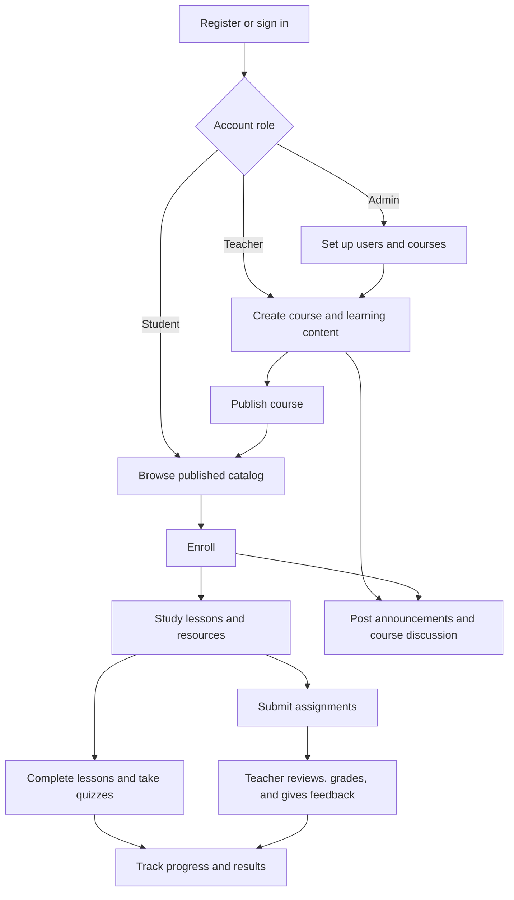

# SmartLearn LMS

SmartLearn is a role based learning management system for publishing courses, guiding learners through lessons, assigning and reviewing work, and managing platform accounts. The web client is built with React, Vite, and Redux Toolkit Query. The API uses Express and MongoDB through Mongoose.

## Table of contents

- [Features](#features)
- [Roles and permissions](#roles-and-permissions)
- [Business and learning workflow](#business-and-learning-workflow)
- [Pages by role](#pages-by-role)
- [Authentication and account lifecycle](#authentication-and-account-lifecycle)
- [Files, quizzes, and communications](#files-quizzes-and-communications)
- [Setup](#setup)
- [Commands and verification](#commands-and-verification)
- [API overview](#api-overview)
- [Data and deployment notes](#data-and-deployment-notes)
- [Current scope](#current-scope)

## Features

### Learning and course authoring

- Course catalog with search, categories, course level, instructor, and publication status.
- Teacher and admin course creation and editing. Admins can assign a course to an active teacher.
- Draft and published course states. Students can discover and enroll in published courses; lesson content is available after enrollment.
- Lessons with module/unit names, written notes, descriptions, external video links, and teacher-uploaded MP4, WebM, OGG, or MOV videos. Enrolled learners can stream uploaded videos in the lesson page.
- Student lesson completion tracking and per-course learner progress.
- Teacher course rosters and a learner overview across courses.

### Assignments and assessment

- Course assignments with instructions and optional due dates.
- Teachers can add multiple short-answer or long-response questions/tasks to each assignment.
- Students answer each required assignment question, add optional notes, and attach one file if the task needs uploaded work.
- Teachers and admins can review submissions, assign a score from 0 to 100, and leave feedback.
- Students can see submission status, scores, and feedback in their assignment and grade views.
- Multiple choice quizzes with draft/published states, server-side scoring, answer feedback, and attempt history.

### Communication and resources

- Course announcements posted by the course teacher or an admin.
- Course group discussion for enrolled students and course staff.
- Course files for handouts and reference materials, with authenticated downloads.
- Assignment attachments are also access controlled: students can access their own submissions, while the course teacher and admins can review course submissions.

### Platform and account management

- Separate student, teacher, and admin workspaces.
- Admin user directory, role changes, account activation/deactivation, and platform reports.
- Profile name editing and authenticated password changes.
- Password recovery and optional email verification when SMTP is configured.
- HTTP-only cookie sessions with session revocation on logout, password changes, and account deactivation.
- API request throttling, origin checks, security response headers, and restricted upload types and sizes.

## Roles and permissions

| Role | Can do | Cannot do |
| --- | --- | --- |
| Student | Browse published courses, enroll, access enrolled lessons and resources, mark lessons complete, take published quizzes, submit assignments, join course discussions, read course announcements, view grades and feedback. | Create or publish courses, manage other learners, see another student's submissions, or access admin tools. |
| Teacher | Create and manage their own courses, write lessons, publish courses, upload course resources, create assignments and quizzes, post announcements, join course discussions, view course rosters and learner progress, grade submissions. | Manage a different teacher's course or manage platform users and roles. |
| Admin | View and manage all courses, assign courses to active teachers, manage user roles and account status, view platform reports, and perform course management and grading actions. | Deactivate their own account or remove/deactivate the last active administrator. |

The API checks the signed-in user's role and, where applicable, course ownership or enrollment. Hiding a page in the client does not grant or remove API access; server permissions remain authoritative.

## Business and learning workflow



### 1. Account creation and access

1. A visitor registers with a name, email, and password of at least eight characters. New accounts are students by default.
2. If `BOOTSTRAP_ADMIN_EMAIL` is configured and no administrator exists yet, the first registration for that email receives the admin role. Once an admin exists, registering that same address cannot create another admin.
3. An admin can promote a trusted student to teacher, change roles, or activate/deactivate accounts from **People**.
4. Users sign in with email and password. The server returns an HTTP-only session cookie; the client restores the signed-in user from `GET /user/me` after a reload.

### 2. Course setup and publication

1. A teacher creates a course with a title, description, category, and level. The teacher is the course owner.
2. An admin can create or edit any course and assign it to an active teacher.
3. The owner adds lessons, optional module names and video links, assignments, quizzes, and course resources. The course remains a draft until published.
4. Publishing makes the course appear in the student catalog. Students can see course information before enrolling, but lesson content and course resources are only available to enrolled learners and course staff.

### 3. Student enrollment and learning

1. A student selects a published course and enrolls. Enrollment is recorded on the student account.
2. Enrolled students open lessons, read content, play teacher-uploaded videos or follow external video links, and mark lessons complete. Completion is saved against the student account and used for course progress views.
3. Students can download course resources, take published quizzes, read course announcements, and participate in the course discussion.
4. Their **My learning**, **Schedule**, **Assignments**, and **Grades** pages summarize enrolled courses, due dates, work status, scores, and teacher feedback.

### 4. Assignment submission and grading

1. A teacher creates an assignment inside a course, writes the instructions, adds one or more questions/tasks, chooses short or long response for each, and can set a due date. The due date appears in the learner schedule.
2. An enrolled student answers each required question/task. They can add general notes and attach one supported file for work such as a document, worksheet, or project. The student can replace their submission; resubmitting clears its previous grade and feedback so the new work can be reviewed.
3. The course teacher or an admin reviews the submission and saves a score from 0 to 100 plus optional feedback.
4. The updated score and feedback become visible to the student and appear in the gradebook.

Assignment answers are reviewed and graded together as one assignment score; per-question scoring and automatic grading are not implemented. Due dates are currently informational: the API does not reject submissions made after the due date.

### 5. Quiz workflow

1. A teacher or admin creates a multiple choice quiz. It starts as a draft and can be published or unpublished from the course page.
2. Only enrolled students can attempt published quizzes. Before submission, the student API response omits the answer key.
3. The API scores the submitted answers and returns the result and any configured explanation. Students can see their own attempt history; course staff can view course quiz attempts.

### 6. Announcements and discussions

- Teachers can post announcements only to courses they own; admins can post to any course. Enrolled students see announcements for their courses.
- Enrolled students, the course teacher, and admins can read and post in that course's group discussion. It is a shared course discussion, not private messaging.

## Pages by role

| Student workspace | Teacher workspace | Admin workspace |
| --- | --- | --- |
| **Learning home:** progress and next steps | **Overview:** teaching summary | **Overview:** platform summary |
| **My learning:** enrolled courses | **My courses:** create and manage owned courses | **Courses:** review and manage all courses |
| **Catalog:** find and enroll in published courses | **Learners:** rosters and progress | **People:** roles and account status |
| **Course room:** lessons, resources, quizzes, announcements, discussion | **Course room/studio:** course content and teaching tools | **Course room:** course management tools |
| **Schedule:** assignment due dates | **Schedule:** assignment planning | **Announcements:** platform course updates |
| **Assignments:** submit and track work | **Assignments:** review and grade work | **Reports:** members, enrollment, and grade summaries |
| **Grades:** scores and feedback | **Profile:** account details and password | **Profile:** account details and password |
| **Announcements** and **Profile** | **Announcements** and **Profile** | **Announcements** and **Profile** |

The account pages `/reset-password` and `/verify-email` handle emailed account links.

## Authentication and account lifecycle

- Passwords are hashed before they are stored. Registration requires at least eight characters.
- Login sessions use a signed JWT in an HTTP-only cookie and expire after one day.
- Logout increments the user's session version and clears the cookie. Password changes and deactivation also invalidate existing sessions.
- **Profile** lets a user change their displayed name. **Change password** requires the current password and reissues the current session.
- **Forgot password** sends a one-time, one-hour reset link when SMTP is configured. Without SMTP, development returns a reset link in the response; that development fallback is disabled in production.
- Email verification is required at registration only when SMTP is configured. Without SMTP, accounts are immediately verified.
- Admins can deactivate accounts. Deactivated accounts cannot sign in or use an existing session. The last active administrator is protected from deactivation or demotion.

## Files, quizzes, and communications

- Course resources accept PDF, DOCX, PPTX, XLSX, plain text, CSV, PNG, JPEG, and WebP. Assignment submissions and profile photos use their own restricted file types.
- The default maximum document upload size is 20 MB (`MAX_UPLOAD_MB`). Lesson videos accept MP4, WebM, OGG, and MOV, up to 500 MB by default (`MAX_VIDEO_MB`).
- Uploaded files are stored on the API server in `UPLOAD_DIR`, defaulting to `server/uploads`. The database stores the file metadata and access relationships; downloads require a valid session and the appropriate course access.
- SMTP configuration is optional. Set `SMTP_HOST`, `SMTP_PORT`, `SMTP_SECURE`, `SMTP_USER`, `SMTP_PASSWORD`, and `EMAIL_FROM` to send verification and recovery emails.
- Quiz answers are scored by the API. Students do not receive correct answers before submitting an attempt.

## Setup

### Requirements

- Node.js 20.19+ or 22.12+.
- A MongoDB database, local or hosted.

### Start the API

1. Copy `server/.env.example` to `server/.env`.
2. Set `MONGO_URI` to the application database and set `JWT_SECRET` to a long, random secret. Set `BOOTSTRAP_ADMIN_EMAIL` to the email address that should receive the initial admin role.
3. Install dependencies and start the API:

   ```sh
   cd server
   npm install
   npm run dev
   ```

The API listens on `http://localhost:8080` by default. Check `GET http://localhost:8080/api/v1/health` for API and MongoDB connection status.

### Start the web client

1. In another terminal, copy `client/.env.example` to `client/.env`. Set `VITE_API_URL` only if the API is not at its default URL.
2. Install dependencies and start Vite:

   ```sh
   cd client
   npm install
   npm run dev
   ```

3. Open `http://localhost:5173`. Register the configured bootstrap email first to create the initial admin. Register other users as students and promote trusted users to teacher from the admin **People** page.

### Optional email and file configuration

- Add the SMTP settings listed above to `server/.env` to deliver email verification and password reset links. In development without SMTP, the reset response contains a link for local testing.
- Set `UPLOAD_DIR` to change the local upload folder, `MAX_UPLOAD_MB` to change the document size limit, and `MAX_VIDEO_MB` to change the lesson video size limit. Back up this folder together with MongoDB. A multi-instance deployment needs shared object storage or a replacement upload adapter.
- Set `CLIENT_URL` to the exact frontend origin accepted by the API. The default is `http://localhost:5173`.

## Commands and verification

Run commands from the relevant directory.

```sh
# client/
npm run dev
npm run lint
npm run build

# server/
npm run dev
npm test
npm start
```

The server workflow test uses `TEST_MONGO_URI`, which must point to a separate disposable database. It creates temporary users and learning records, runs student/teacher/admin workflows, and removes those records afterward.

## API overview

All endpoints below are prefixed by `/api/v1`. Authenticated requests use the HTTP-only cookie set at login.

| Area | Routes | Access |
| --- | --- | --- |
| Account | `POST /user/register`, `POST /user/login`, `GET /user/me`, `POST /user/logout` | Registration/login public; `/me` and logout signed in |
| Recovery | `POST /user/forgot-password`, `POST /user/reset-password`, `POST /user/verify-email`, `POST /user/resend-verification` | Public; reset/verification use one-time tokens, while resend accepts an email address |
| Profile | `PATCH /user/me/profile`, `PATCH /user/me/password` | Signed in |
| People | `GET /user`, `PATCH /user/:id/role`, `PATCH /user/:id/status` | Admin |
| Courses | `GET /courses`, `GET /courses/:id`, `POST /courses`, `PATCH /courses/:id`, `DELETE /courses/:id` | Signed in; management is restricted to course owner/admin |
| Lessons and enrollment | `POST /courses/:id/lessons`, `PATCH/DELETE /courses/:id/lessons/:lessonId`, `POST /courses/:id/enroll`, `POST /courses/:id/lessons/:lessonId/complete` | Course owner/admin manages lessons; published-course student enrolls; enrolled student tracks progress |
| Rosters | `GET /courses/students`, `GET /courses/:id/students` | Teacher for their courses; admin for all courses |
| Assignments | `GET /assignments`, `POST /assignments/course/:courseId`, `PATCH/DELETE /assignments/:id`, `POST /assignments/:id/submit`, `PATCH /assignments/:id/submissions/:submissionId` | Course owner/admin manages and grades; enrolled students submit; deletion is blocked when submissions exist |
| Course files and lesson videos | `POST /courses/:id/resources`, `DELETE /courses/:id/resources/:resourceId`, multipart `POST/PATCH /courses/:id/lessons[/:lessonId]`, `GET /resources/:id/download`, `GET /resources/:id/video` | Course owner/admin uploads and manages; students must be enrolled to stream lesson videos or download resources |
| Quizzes | `GET /courses/:courseId/quizzes`, `POST /courses/:courseId/quizzes`, `PATCH /assignments/quizzes/:id`, `POST /quizzes/:id/attempt`, `GET /assignments/quizzes/:id/attempts` | Course staff manage; enrolled students attempt and view their own results |
| Announcements | `GET /communication/announcements`, `POST /courses/:courseId/announcements`, `PATCH/DELETE /communication/announcements/:id` | Teachers manage their own announcements for owned courses; admins can manage all |
| Discussion | `GET/POST /communication/courses/:courseId/messages` | Enrolled students, course teacher, or admin |

## Data and deployment notes

- MongoDB stores users, courses and lessons, enrollments/progress, assignments/submissions/grades, quizzes/attempts, announcements, messages, and account recovery tokens.
- Uploaded file bytes live in `UPLOAD_DIR`; MongoDB stores their names, sizes, MIME types, and course/submission references. Database backups alone do not include the file bytes.
- Set `NODE_ENV=production`, use HTTPS for both client and API, set a strong secret, and configure the exact `CLIENT_URL` and SMTP credentials before deploying. Production cookies are secure and cross-site compatible.
- The included rate limiter is process-local. For a horizontally scaled deployment, use shared rate-limit storage and shared file storage.

## Current scope

SmartLearn currently supports course based learning, lessons with external video links or local uploaded video files, structured short/long response assignments, multiple choice quizzes, shared course announcements and discussions, and local file uploads. Payments, certificates, live video classes, private messaging, calendar integrations, and cloud object storage are not implemented.
